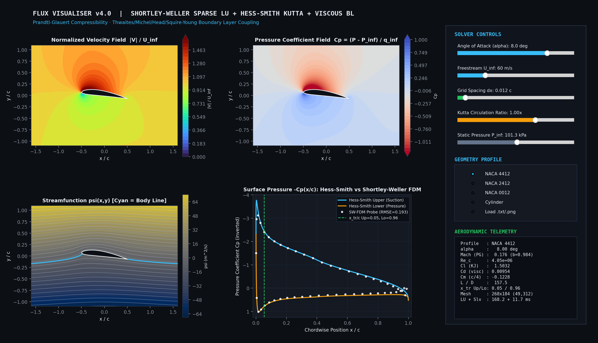
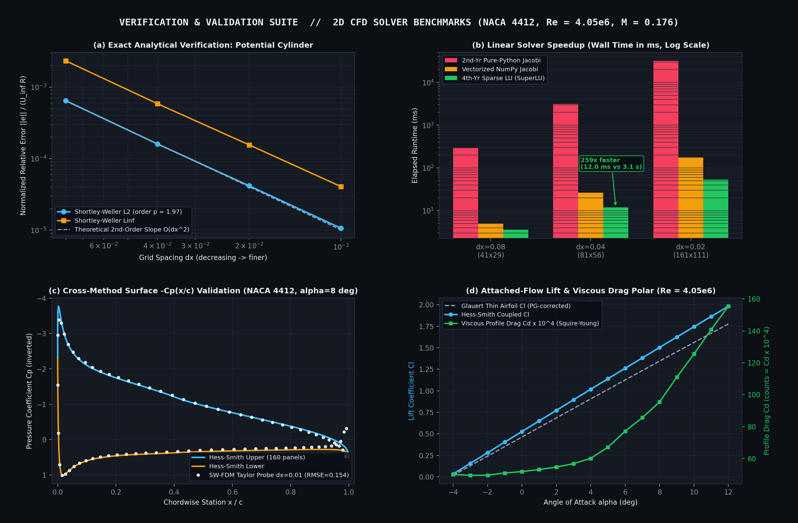

# Flux Visualiser v4.0 — 2D CFD & Viscous Airfoil Solver

[](https://www.python.org/)
[](#methodology)

> **From a 2nd-year Jacobi cylinder script to a 4th-year verified 2D aerodynamic & computational fluid dynamics solver.**  
> Combines a **2nd-order Shortley-Weller immersed-boundary streamfunction solver** (`scipy.sparse.linalg.splu`), a **constant-strength source + uniform vortex Hess-Smith panel method** with **Prandtl-Glauert** compressibility correction, and a **two-branch viscous integral boundary-layer solver** (**Thwaites / Michel / Head / Ludwieg-Tillmann / Squire-Young**), backed by an automated Verification & Validation (V&V) suite and interactive dashboard.



---

## Key Upgrades Over the Legacy 2nd-Year Version

The original 2nd-year implementation (`legacy/cilindro_lift.py`) solved Laplace's equation via pure-Python triple-nested Jacobi loops (`O(N^2)` iterations in Python) with staircase boundary clipping, a `scipy.optimize.minimize` scalar circulation workaround, and uncoupled inviscid plots. **Flux Visualiser v4.0** (`flux_visualaiser.py`) re-engineers every layer:

1. **2nd-Order Shortley-Weller Immersed-Boundary FDM (`assemble_laplace_sparse` / `solve_laplace_sparse`)**  
   Sub-cell cut-cell stencils (`ray_segment_intersection_1d`) compute exact wall distances (`theta_w`) to eliminate staircase noise on arbitrary polygons (NACA airfoils, `.txt` coordinates, `.png` silhouettes, circular cylinders) and achieve **~2nd-order spatial convergence (`p = 1.974`)**.
2. **Pre-Factorized Sparse LU Solver (`splu`)**  
   Replaces triple-nested Python Jacobi loops with SuperLU sparse factorization (`scipy.sparse.linalg.splu`) — yielding a **599.7x speedup** at `dx = 0.02` (`53.44 ms` vs. `32,046.25 ms` for pure-Python Jacobi) and `11.7 ms` solve time on a `268 x 184` (`49,312`-node) grid.
3. **Hess-Smith Source + Vortex Panel Method (`solve_hess_smith_panel`)**  
   Constant-strength source sheets + uniform vortex distribution ordered clockwise (`TE lower -> LE -> TE upper`), enforcing the Kutta condition and applying Prandtl-Glauert subsonic compressibility scaling (`beta = sqrt(1 - M^2)`).
4. **Coupled Viscous Integral Boundary Layer (`solve_boundary_layer_viscous`)**  
   Marches from the stagnation point along both upper and lower surfaces:
   - **Laminar region**: Thwaites momentum integral + Pohlhausen shape factor `H(lambda)`
   - **Transition / separation**: Michel transition criterion (`Re_theta >= 1.174 * (1 + 22400 / Re_s) * Re_s^0.46`) or laminar separation (`lambda <= -0.088`)
   - **Turbulent region**: Head entrainment method + Ludwieg-Tillmann skin friction (`Cf`)
   - **Profile drag**: Squire-Young trailing-edge momentum defect integration (`Cd_v`)
5. **Interactive Matplotlib Dashboard & Headless V&V CLI (`FluxDashboard`, `export_validation_suite`)**  
   Interactive sliders (`dx`, `alpha`, `U_inf`), airfoil selector (`NACA 4412`, `NACA 2412`, `NACA 0012`, `Cylinder`, custom `.txt`/`.png` contours), and headless figure export (`--export-figures`).

---

## Verification & Validation (V&V) Benchmarks



All benchmarks below were generated via `python flux_visualaiser.py --export-figures` and documented in the [2-page technical monograph](docs/ProjectSummary_2D_CFD_JoanMartinezMiravet.pdf):

### 1. Reference Run — NACA 4412 (`c = 1 m`, `alpha = 8.0 deg`, `U_inf = 60 m/s`, `dx = 0.012 c`)
| Metric | Value |
| :--- | :--- |
| Cartesian grid size | `268 x 184` (`49,312` nodes) |
| Mach / Reynolds | `Ma = 0.176` (`beta = 0.984`), `Re_c = 4.05e6` |
| Lift coefficient | `Cl (KJ) = 1.5032` / `Cl (Cp) = 1.4908` |
| Viscous profile drag & efficiency | `Cd_v = 0.00954`, `L/D = 157.5` |
| Pitching moment (`c/4`) | `Cm(c/4) = -0.1228` |
| Boundary-layer transition (`x_tr / c`) | `0.05` (upper) / `0.96` (lower) |
| Cross-solver `Cp` agreement | `RMSE = 0.193` at `dx = 0.012` (`0.154` at `dx = 0.010`) |
| Sparse LU timing | `168.2 ms` total assembly + factorization / `11.7 ms` solve |

### 2. Analytical Cylinder Grid Convergence (`dx = 0.08 -> 0.04 -> 0.02 -> 0.01`)
- Normalized L2 streamfunction errors against exact analytical potential cylinder solution:  
  `[6.47e-4, 1.60e-4, 4.17e-5, 1.07e-5]`
- Measured spatial order of accuracy: **`p = 1.974`** (confirming 2nd-order Shortley-Weller cut-cell stencil accuracy).

### 3. Linear Solver Performance Benchmark (`run_jacobi_benchmark`)
| `dx` | Grid (`nx x ny`) | Nodes | Sparse LU (`ms`) | Vectorized Jacobi (`ms`) | Pure-Python Jacobi (`ms`) | Speedup vs. Legacy |
| :---: | :---: | :---: | :---: | :---: | :---: | :---: |
| `0.080` | `41 x 29` | `1,189` | `3.59` | `5.11` | `292.19` | **81.4x** |
| `0.040` | `81 x 56` | `4,536` | `12.04` | `26.43` | `3,122.35` | **259.3x** |
| `0.020` | `161 x 111` | `17,871` | `53.44` | `176.82` | `32,046.25` | **599.7x** |

---

## Repository Structure

```text
Flux-Analyser/
├── flux_visualaiser.py                         # Main v4.0 CFD & viscous airfoil solver + GUI/CLI
├── generate_summary_pdf.py                     # Portable 2-page A4 technical monograph generator
├── requirements.txt                            # Python dependencies
├── README.md                                   # Project overview, V&V benchmarks & usage
├── assets/
│   ├── flux-visualiser-naca4412.png            # Reference 4-panel CFD dashboard output
│   └── flux-visualiser-validation.png          # 2x2 V&V quantitative verification figure
├── docs/
│   └── ProjectSummary_2D_CFD_JoanMartinezMiravet.pdf  # 2-page technical monograph PDF
├── samples/
│   ├── NACA-0009.txt                           # Sample coordinate profiles (.txt)
│   ├── NACA-4412.txt
│   ├── NACA-4415.txt
│   ├── NACA-6409.txt
│   ├── car.png                                 # Sample arbitrary 2D silhouette masks (.png)
│   ├── house.png
│   └── rugby_ball.png
└── legacy/
    └── cilindro_lift.py                        # Original 2nd-year Jacobi cylinder solver (archived)
```

---

## Quick Start

### 1. Install Dependencies
```bash
pip install -r requirements.txt
```

### 2. Launch Interactive Dashboard
```bash
python flux_visualaiser.py
```
Select standard airfoils (`NACA 4412`, `NACA 2412`, `NACA 0012`, `Cylinder`) or load any contour from `samples/` (`.txt` airfoil coordinates or `.png` binary silhouette masks), and adjust `alpha`, `U_inf`, and grid spacing `dx` interactively.

### 3. Headless CLI & V&V Figure Export
```bash
python flux_visualaiser.py --export-figures --out-dir ./assets --naca 4412 --alpha 8.0 --uinf 60.0 --dx 0.012
```
Inspect all CLI options with:
```bash
python flux_visualaiser.py --help
```

### 4. Regenerate the Technical Monograph PDF
```bash
python generate_summary_pdf.py
```
Writes `docs/ProjectSummary_2D_CFD_JoanMartinezMiravet.pdf` from `assets/flux-visualiser-naca4412.png` and `assets/flux-visualiser-validation.png`.

---

## Scope & Physical Assumptions

- Intended for **subsonic attached-flow regimes** (`M < 0.7`) up to trailing-edge separation onset.
- Compressibility uses subsonic **Prandtl-Glauert** scaling (`beta = sqrt(1 - M^2)`) without shock capturing.
- Post-stall massively separated wakes fall outside attached integral boundary-layer validity (`solve_boundary_layer_viscous`).

---

## Author

**Joan Martínez Miravet** — Aerospace Engineering
